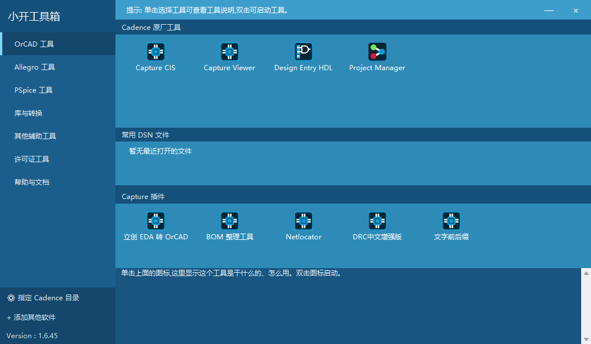

# 小开工具箱

面向 Windows 的 OrCAD / Allegro 工具启动器，以及用于 Capture 的原理图辅助插件。按分类查找本机已安装的 Cadence 工具，支持添加自己的软件快捷方式。



## 下载与安装

前往 **[Releases](https://github.com/KavasDD/XKGJX/releases)** 下载最新版本。

- 安装版：运行 `XiaokaiToolbox-setup-v版本.exe`，安装主程序和所需组件，自动部署 Capture 插件；完成后重启 Capture。
- 绿色版：解压 ZIP，运行 `XiaokaiToolbox.exe`；绿色版不会自动安装 Capture 插件。
- 每次发行同时提供对应源码 ZIP、SHA-256 校验文件和构建说明。不要用仓库里的源码 ZIP 代替运行包。

运行环境：Windows 10 / 11、.NET Framework 4.x。OrCAD 插件已在 Capture CIS 17.4 上有历史验证记录；其他版本尚未验证。Cadence 软件由用户自行安装和取得授权，本项目不包含 Cadence 程序或许可证。

安装器优先查找 Capture 用户配置目录，找不到时检查实际 Capture 安装目录。自动查找失败时会提示选择这台电脑上的 SPB 安装目录、SPB_Data 或 capAutoLoad，选择插件目录与工具箱安装位置是两回事。用户配置已存在但缺少 capAutoLoad 时会自动创建；写入权限会在复制工具文件前检查。也可设置环境变量 `XIAOKAI_CAPTURE_AUTOLOAD` 指向实际 capAutoLoad 目录。

## 功能

| 功能 | 用途 |
| --- | --- |
| 分类启动器 | 检测本机 Cadence 安装位置，分类启动 OrCAD、Allegro、PSpice 等工具 |
| 自定义软件与最近文件 | 添加个人软件快捷方式，显示 Windows 最近项目中的 DSN / BRD |
| 立创 EDA 转 OrCAD | 按立创编号获取并放置元器件符号 |
| BOM 整理 | 从原理图或 TXT / CSV 整理并导出 Excel 工作簿 |
| Netlocator | 跨页定位网络、选择当前页整网 |
| DRC 中文增强版 | 运行指定原生检查，按问题归纳并定位 |
| 文字前后缀 | 为所选原理图文字添加或去除指定前后缀 |
| 启动优化 | 备份后停用可选启动功能，并支持恢复 |
| 配套工具 | 元器件规格描述生成器、嘉立创 3D 模型下载器 |

在 Capture 原理图中按 **Alt+K** 打开插件集合。Netlocator 快捷键为 **Alt+F2 / Alt+F3**。

DWG / STEP / Gerber 转 DXF 的源码与单独构建脚本也在仓库中；这些大型转换器不包含在主安装包里。可自行构建，然后通过“添加其他软件”加入工具箱。

主界面的“添加其他软件”写入 `tools.local.ini`，升级会保留该文件。随包的 `tools.ini` 会随升级替换。

退出工具箱会先请求关闭由它启动的程序，等待 8 秒后结束仍运行的进程树，请先保存工作。卸载默认保留 Capture 插件；取消保留会移除工具箱管理的插件，并恢复安装前备份。

## 从源码构建

只构建启动器和启动优化工具，需要 Windows PowerShell 5.1、.NET Framework 4.x：

```powershell
powershell -NoProfile -File toolbox/build.ps1
```

产物在 `toolbox/out/`。构建完整发行版需要 Python 3.12（包含 tkinter）：

```powershell
python -m venv .venv
.\.venv\Scripts\python.exe -m pip install -r requirements-build.txt
powershell -NoProfile -File scripts/build-release.ps1 -Python .\.venv\Scripts\python.exe
```

完整步骤、测试方法和可选转换器依赖见 [构建说明](docs/BUILDING.md)。主程序源码不要求安装 Visual Studio。

## 文档与反馈

- [BOM 整理](toolbox/bomtool/README.md)
- [DRC 中文增强版](toolbox/drc/README.md)
- [文字前后缀](toolbox/textaffix/README.md)
- [启动优化](toolbox/startupoptimizer/README.md)
- [更新记录](CHANGELOG.md)
- [提交问题](https://github.com/KavasDD/XKGJX/issues) · [参与贡献](CONTRIBUTING.md)

问题反馈请包含版本、Windows / Capture 版本、操作步骤与脱敏日志。第三方在线接口可能变化；项目不保证这些接口永久可用。下载的模型、器件数据以及用户工程不自动适用本项目许可证。

## 开源许可

本项目按 **GNU GPL v3.0（GPL-3.0-only）** 发布，完整条款见 [LICENSE](LICENSE)。允许使用、修改和商用；向他人分发修改版或二进制时，应保留声明、标明修改，并按 GPL 提供完整对应源码与构建脚本。仅自己使用的修改无需公开；GPL 并不要求必须上传到 GitHub。

第三方作者署名、单独授权及依赖许可证见 [第三方声明](THIRD_PARTY_NOTICES.md)。没有任何明示或暗示的担保。
